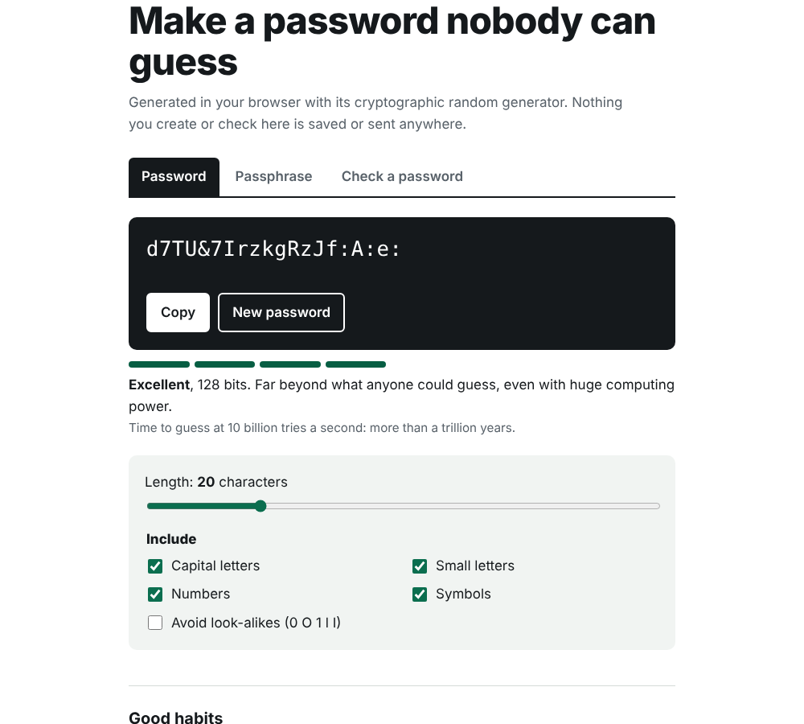
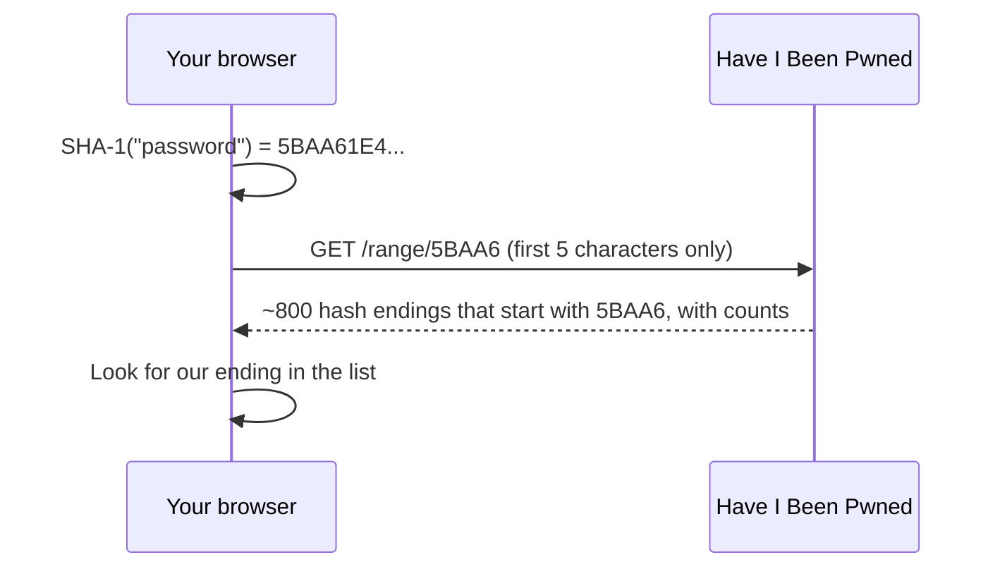

# Password and Passphrase Generator

[](https://github.com/macroer16/password-generator/actions/workflows/test.yml)

Generates secure passwords and passphrases in your browser, shows their real strength in bits, and checks whether a password has appeared in a data breach without ever sending the password anywhere.

**[Try it live](https://macroer16.github.io/password-generator/)**



## Why I rebuilt it

The first version used `Math.random()`, which is **not secure** for passwords. Its output can be predicted, and browsers say not to use it for anything security-related. It also didn't guarantee that the character types you ticked actually appeared, and its "strength" rating was a guess. Version 2 fixes all three.

## What it does

- **Secure passwords** from the Web Crypto API (`crypto.getRandomValues`), using rejection sampling so no character is more likely than another.
- **Every chosen type is guaranteed:** at least one capital, small letter, number or symbol as ticked, then the whole password is shuffled.
- **Avoid look-alikes:** optionally leave out 0, O, 1, l and I for passwords you'll type by hand.
- **Passphrases:** random words from the EFF's 7,776-word list, which are easier to remember. You can change the word count, separator, capitals and add a number.
- **Real strength:** entropy in bits (length × log₂(pool size) for passwords, words × log₂(7,776) for passphrases), a rating, and how long guessing would take at 10 billion tries a second.
- **Breach check:** tells you if a password has appeared in a known data breach, using Have I Been Pwned's k-anonymity method (see below).
- **Nothing is stored:** no accounts, no cookies, no saved passwords.

## How the breach check stays private



Only the first 5 characters of the hash leave the page. Hundreds of different passwords share those 5 characters, so the service can't tell which one you checked. The request also asks for padding (`Add-Padding: true`), so the size of the reply doesn't give anything away either.

## How it's built

- **`src/generator.js`**: generation, entropy, ratings and breach-check helpers. Pure functions that also run in Node, so they're tested.
- **`src/wordlist.js`**: the EFF large wordlist.
- **`src/app.js`**: the interface: tabs, strength meter, copy and the breach check.
- Plain JavaScript modules, no build step, hosted on GitHub Pages.

## Run it locally

```bash
git clone https://github.com/macroer16/password-generator.git
cd password-generator
python3 -m http.server 8000
# open http://localhost:8000
```

## Tests

```bash
npm test
```

There are 18 tests covering:
- the random range, including a test that the biased tail is rejected and redrawn, and a check that results are spread evenly
- guaranteed character types (run 300 times)
- the look-alike filter
- input validation
- the word list (7,776 unique words)
- passphrase options
- entropy maths and ratings
- a known SHA-1 test vector
- that only a 5-character prefix is sent
- parsing the breach API's response

GitHub Actions runs them on every push.

## Limitations

- The strength meter measures *generated* passwords. A password you made up yourself is weaker than its length suggests, which is why the check tab only reports breaches.
- The breach check needs an internet connection and depends on the Have I Been Pwned service.

## What I learned

_TODO (Victor writes this)_

## Next steps

- [ ] Clear the clipboard automatically after 30 seconds
- [ ] Translate the interface
- [ ] Offline mode as an installable app

## Credits

- Passphrase words: [EFF large wordlist](https://www.eff.org/dice), CC BY 3.0 US.
- Breach data: [Have I Been Pwned: Pwned Passwords](https://haveibeenpwned.com/Passwords).

Built by [Victor Benson](https://macroer16.github.io/victor-cloud-portfolio/).
